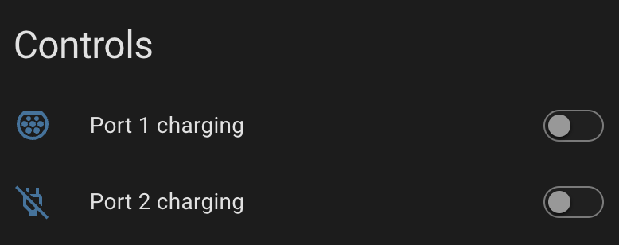
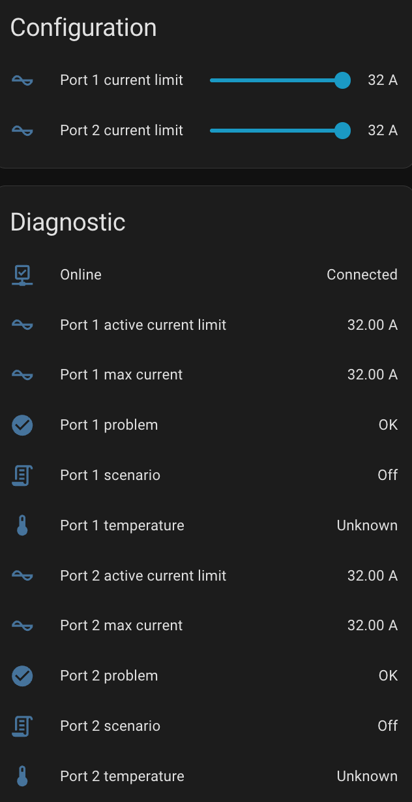
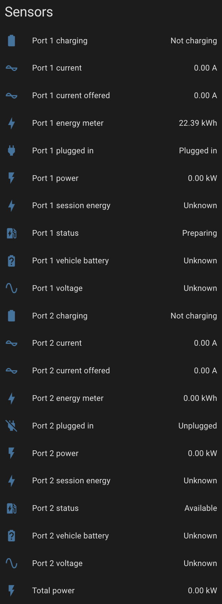
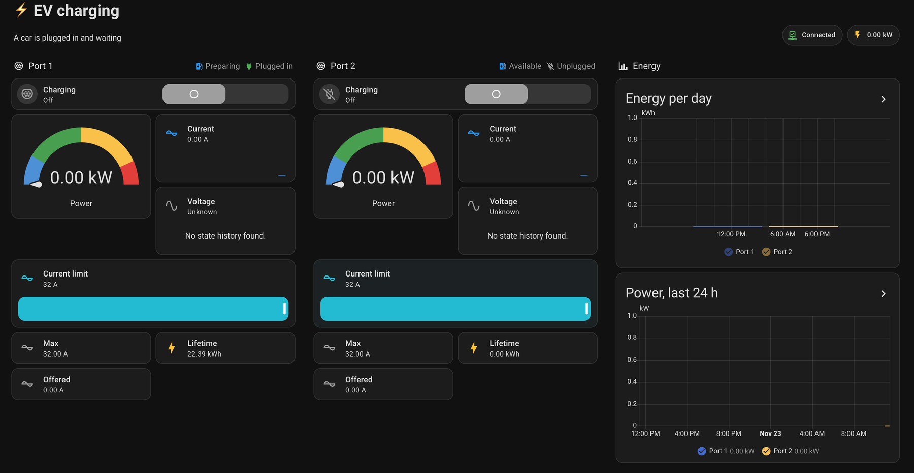

# Octa EV Charger for Home Assistant

[](https://github.com/maistrovyi/octa-ev-charger-ha/actions/workflows/release.yml)
[](https://github.com/maistrovyi/octa-ev-charger-ha/releases/latest)
[](https://hacs.xyz/docs/faq/custom_repositories)

Custom integration that connects an EV charging station to Home Assistant through the station's
**Home Assistant API** (`/api/home-assistant/v1/stations/<station>/…`). Each station becomes one
device with live readings, a charging switch and a current-limit slider per port.

- Set up from the UI. No YAML needed.
- One HTTP request per poll updates every entity, every 30 s by default (configurable).
- Stations with 1, 2 or 3 ports (or more): ports are detected automatically, including ones the
  station reports only after startup, without a restart.
- Lifetime energy meters plug straight into the **Energy** dashboard.
- Re-authentication prompt when the token is rejected, and diagnostics with secrets redacted.
- English and Ukrainian (українська) translations.

## Screenshots

The station's device page in Home Assistant:

<table>
  <tr>
    <td valign="top" width="50%">
      
      <br><br>
      
    </td>
    <td valign="top" width="50%">
      
    </td>
  </tr>
</table>

## Dashboard

A ready-made dashboard view with live status, start/stop, power gauges, current limit sliders and
daily energy, built from Home Assistant's own cards (nothing extra to install):



Copy [`examples/dashboard.yaml`](examples/dashboard.yaml) (written for a 2-port station: delete the
`Port 2` section for a 1-port station, or copy it as `Port 3` for a 3-port one), replace `my_station` with your station ID,
then in Home Assistant open a dashboard → ✏️ **Edit** → ✏️ on a view (or add a new one) → ⋮ →
**Edit in YAML**, paste and save. Cards that have nothing to show (car battery, session energy,
faults) stay hidden until they do.

## Requirements

- Home Assistant **2025.8** or newer. The Octa icon on the integration card needs **2026.3** or
  newer; older versions work the same but show a generic icon.
- The server URL, your station ID and an API token. Reading values needs a *view* token;
  start/stop and current limit need a *view and control* token.

## Installation

### HACS (recommended)

1. HACS → ⋮ → **Custom repositories** → add
   `https://github.com/maistrovyi/octa-ev-charger-ha`, type **Integration**.
2. Search for **Octa EV Charger**, install it, and restart Home Assistant.

### Manual

1. Download `octa_ev_charger.zip` from the
   [latest release](https://github.com/maistrovyi/octa-ev-charger-ha/releases/latest) and unzip it
   into `/config/custom_components/octa_ev_charger/`.
2. Restart Home Assistant.

## Configuration

**Settings → Devices & services → Add integration → Octa EV Charger**

| Field       | Example                  | Notes                                           |
|-------------|--------------------------|-------------------------------------------------|
| Server URL  | `https://ev.example.com` | `https://` is added if you leave it out.        |
| Station ID  | `my-station`             | As it appears in `…/stations/<station ID>/…`.   |
| API token   | `ha_…`                   | With or without the `Bearer ` prefix.           |

Add the integration once per station. To change the polling interval, open the integration and
click **Configure** (minimum 10 s).

## Entities

Entity IDs follow the device name: `<platform>.ev_station_<station_id>_<entity>`. For example, for
station `my-station`, the port 1 power sensor is `sensor.ev_station_my_station_port_1_power`.

**Station**

| Entity        | Type          | Notes                                                   |
|---------------|---------------|---------------------------------------------------------|
| Online        | binary sensor | Off when the station is offline *or* the API is unreachable. |
| Total power   | sensor (kW)   | Sum of all ports.                                       |

**Per port** (`Port N …`)

Every port the station reports gets the entities below on the same device. If the station is
offline when Home Assistant starts, port entities appear as soon as it reports its ports. A port
that disappears keeps its entities (shown as unavailable), so dashboards and history are not lost.

| Entity               | Type             | Notes |
|----------------------|------------------|-------|
| charging             | switch           | On = charging. Turning on/off sends start/stop. |
| current limit        | number (A)       | Slider from 6 A to the port's `current_max_a`. |
| charging             | binary sensor    | From the API's `charging` flag. |
| plugged in           | binary sensor    | Derived from `status` (see below). |
| problem              | binary sensor    | `Faulted` or `Unavailable`. Diagnostic. |
| status               | sensor           | Raw status text, e.g. `Charging`. |
| power                | sensor (kW)      | |
| current              | sensor (A)       | |
| current offered      | sensor (A)       | What the station currently allows the car to draw. |
| voltage              | sensor (V)       | |
| vehicle battery      | sensor (%)       | Only if the car reports it. |
| session energy       | sensor (kWh)     | Resets each session. |
| energy meter         | sensor (kWh)     | Lifetime total; use this in the Energy dashboard. |
| active current limit | sensor (A)       | Saved limit, or the port maximum if none is saved. Diagnostic. |
| max current          | sensor (A)       | Hardware maximum. Diagnostic. |
| temperature          | sensor (°C)      | Diagnostic. |
| scenario             | sensor           | Diagnostic. |
| current L1–L3, voltage L1–L3 | sensors  | Disabled by default. Enable them on the device page. |
| start, stop          | buttons          | Disabled by default; the switch does the same. |

Values the station reports as `null` show as **unknown**, never as 0, so energy statistics are not
corrupted by a glitch.

### How "plugged in" is decided

The API has no plug flag, so the integration reads the port `status` (case-insensitive):

| Status                                                   | plugged in | problem |
|----------------------------------------------------------|:----------:|:-------:|
| `Available`                                              | off        | off     |
| `Preparing`, `Charging`, `SuspendedEV`, `SuspendedEVSE`, `Finishing` | on | off |
| `Faulted`, `Unavailable`                                 | off        | on      |

These are the standard OCPP connector statuses. If your station reports different words, open an
issue with a diagnostics file (see below).

## Languages

The setup screens, entity names and error messages are available in **English** and
**Ukrainian**. They follow the language set under *Settings → System → General*. Entity IDs are
always generated in English (`…_port_1_power`), so automations work in any language.

To add a language, copy `custom_components/octa_ev_charger/translations/en.json` to `<code>.json`
(for example `pl.json`), translate the values, keep every `{placeholder}`, and open a pull request.
The tests check that every language has the same keys and placeholders as English.

## Energy dashboard

**Settings → Dashboards → Energy → Add consumption** and pick
`sensor.ev_station_<station_id>_port_N_energy_meter`. For daily/monthly totals, create a
**Utility Meter** helper from the same sensor.

## Example automations

See [`examples/automations.yaml`](examples/automations.yaml): night-time start at 23:00 only when a
car is plugged in, a notification when a car is connected or a session finishes, and an alert when
the station goes offline or reports a fault.

## Troubleshooting

- **Download diagnostics:** Settings → Devices & services → Octa EV Charger → ⋮ → *Download
  diagnostics*. Server URL, station ID and token are redacted, so the file is safe to attach to an issue.
- **Debug logging:**
  ```yaml
  logger:
    logs:
      custom_components.octa_ev_charger: debug
  ```
- **"Token rejected" notification:** create a new token and enter it in the prompt Home Assistant shows.
- **Start/stop fails:** the token needs *view and control* rights.

## Development

```bash
python3.14 -m venv .venv && source .venv/bin/activate
pip install -r requirements_test.txt
ruff check . && ruff format --check .
pytest --cov
```

Pull requests run the tests on the newest Home Assistant supported by
[`pytest-homeassistant-custom-component`](https://github.com/MatthewFlamm/pytest-homeassistant-custom-component)
and on the oldest supported release (2025.8, Python 3.13), plus `hassfest` and the HACS
validator. Code must stay Python 3.13-compatible, which ruff enforces via `target-version`.

### Versioning and releases

Versions are calendar-based: `YY.MM.PATCH`, for example `26.11.3`.

- The **baseline** (`YY.MM`) is the `version` in
  [`manifest.json`](custom_components/octa_ev_charger/manifest.json), kept at patch `0`
  (`26.11.0`).
- **Every push to `main`** runs the tests and validation. If they pass, the
  [Release workflow](.github/workflows/release.yml) tags the commit with the next free patch
  (`26.11.0`, `26.11.1`, …) and publishes a GitHub release with `octa_ev_charger.zip`. The zip's
  manifest carries that exact version.
- **Release notes** are built from the commit messages since the previous release, grouped by
  their prefix, so write commit subjects as you'd want them in the notes:
  `[core]: support stations with 3 ports` lands under **Core**, `[ops]: …` under **Ops**,
  Dependabot updates under **Dependencies**, and anything without a prefix under **Other**.
  [CHANGELOG.md](CHANGELOG.md) only points to the Releases page, so it never goes stale.
- **To start a new series,** change the manifest version to e.g. `26.12.0` and push. Patches
  restart at `26.12.0`.
- Re-running the workflow on an already-released commit does nothing.

The logic is in [`script/release.py`](script/release.py) and covered by `tests/test_release.py`:

```bash
python script/release.py next-version   # what the next push would release
python script/release.py build 26.11.5  # build dist/octa_ev_charger.zip locally
python script/release.py notes 26.11.5  # preview the release notes for unreleased commits
```

## License

[MIT](LICENSE)
